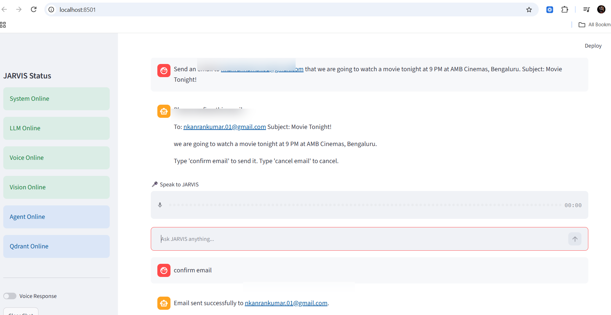
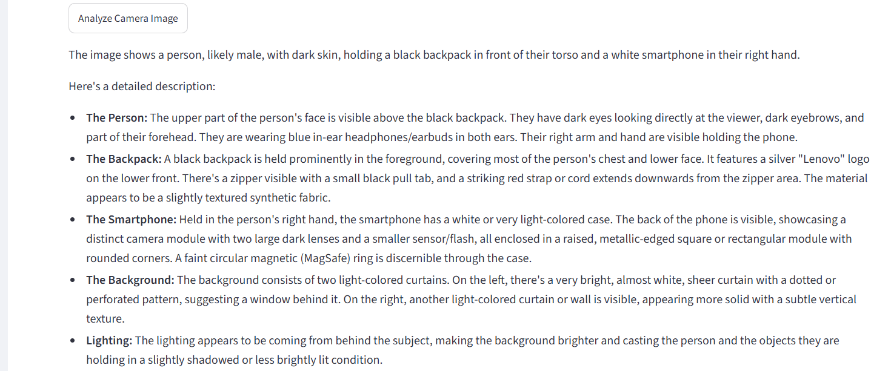

# JARVIS — Multimodal Agentic AI Assistant

**A Python-based desktop AI assistant that can plan actions, use tools, understand images, answer document questions, and interact with connected services.**

JARVIS brings agent orchestration, retrieval-augmented generation (RAG), voice and vision features, browser/desktop automation, and Google Workspace integrations into one Streamlit interface.

> **Project status:** Local application and working prototype. Browser and desktop operations require a local environment; this repository is not a hosted public demo.

## Demo highlights

### Gmail — confirmation before sending

JARVIS extracts the recipient, subject, and message from a natural-language request, presents a preview, and sends through Gmail only after the user confirms. The screenshot shows a successful response from the app.



### Vision — image understanding

JARVIS accepts uploaded images or a camera capture and generates a description using its image-analysis pipeline. The camera interface is manually enabled by the user.



### YouTube — search and playback

JARVIS can interpret requests such as *“Open YouTube and play Shape of You by Ed Sheeran”*, search for a matching video, open it, and attempt playback through Playwright. Browser autoplay policies and YouTube page changes can affect reliability.

## Features

| Area | Capabilities |
|---|---|
| **Agent orchestration** | LangGraph planning, tool routing, permission checks, confirmation, and bounded retry logic |
| **Browser & desktop tools** | Open websites and applications, Google/YouTube search, YouTube playback, scrolling, navigation |
| **Gmail integration** | Search/read email metadata, summarize inbox, compose and send after explicit confirmation |
| **Google integrations** | Calendar events and Contacts lookup through OAuth-enabled APIs |
| **RAG** | Document loading, embeddings, vector retrieval, and document-grounded Q&A using Qdrant |
| **Vision** | Image upload, camera capture on demand, image analysis |
| **Voice** | Speech-to-text and text-to-speech modules |
| **Memory** | SQLite-backed local memory |
| **Interface** | Streamlit chat, document, and vision experiences |

## Architecture

```text
User (text / voice / image / documents)
                    |
             Streamlit UI
                    |
             Core controller
                    |
       +------------+-------------+
       |            |             |
   LangGraph     RAG pipeline   Direct integrations
   planner       + Qdrant       Gmail / Calendar /
       |                         Contacts / Memory
   Permission checks
       |
   Tool execution
       |
 Browser / Desktop / YouTube
```

## Technology

Python 3.11 · Streamlit · LangGraph · Gemini · Qdrant · SQLite · Playwright · Google APIs

## Repository structure

```text
agent/          Planning, routing, and LangGraph workflow
core/           LLM, controller, permissions, confirmations
integrations/   Gmail, Calendar, Contacts
memory/         SQLite persistence
models/         Action and data schemas
rag/            Document processing, embeddings, retrieval
tools/         Browser and desktop automation
ui/             Streamlit UI components
vision/         Image analysis
voice/          Speech-to-text and text-to-speech
app.py          Streamlit entry point
requirements.txt
```

## Run locally

1. Clone this repository and open a terminal in the project directory.
2. Create and activate a Python 3.11 virtual environment.
3. Install dependencies:

   ```bash
   pip install -r requirements.txt
   ```

4. Configure the required API keys and service credentials **locally**. Google OAuth integrations require your own OAuth client configuration and consent. Check the relevant modules for their configuration requirements.
5. Start the application:

   ```bash
   streamlit run app.py
   ```

6. Open the local URL printed by Streamlit (normally `http://localhost:8501`).

**Privacy & security:** Never commit `.env`, OAuth client secrets, refresh/access tokens, private documents, local databases, or logs. Sensitive actions such as sending an email require user confirmation. Review tool permissions before enabling browser or desktop automation.

## Design decisions

- **Tool use instead of chat-only responses:** Distinct actions for Gmail, browser automation, and document retrieval.
- **Human-in-the-loop control:** A confirmation step before email delivery.
- **Local-first workflow:** Desktop/browser actions run on the user's own machine.
- **Modular architecture:** Separate planner, router, integrations, RAG, voice, and vision components.

## Limitations and next steps

- Browser automation depends on external website layouts and autoplay restrictions.
- Google APIs require valid OAuth credentials and permissions.
- Add automated end-to-end tests, structured tool-call telemetry, and evaluation benchmarks.
- Add a short **redacted** demonstration showing actual YouTube playback and a complete email workflow.

## Author

**Karunkumar** · [GitHub profile](https://github.com/KarunkumarAI)

Also see: [Self-Healing Multilingual RAG](https://github.com/KarunkumarAI/multilingual-rag)
